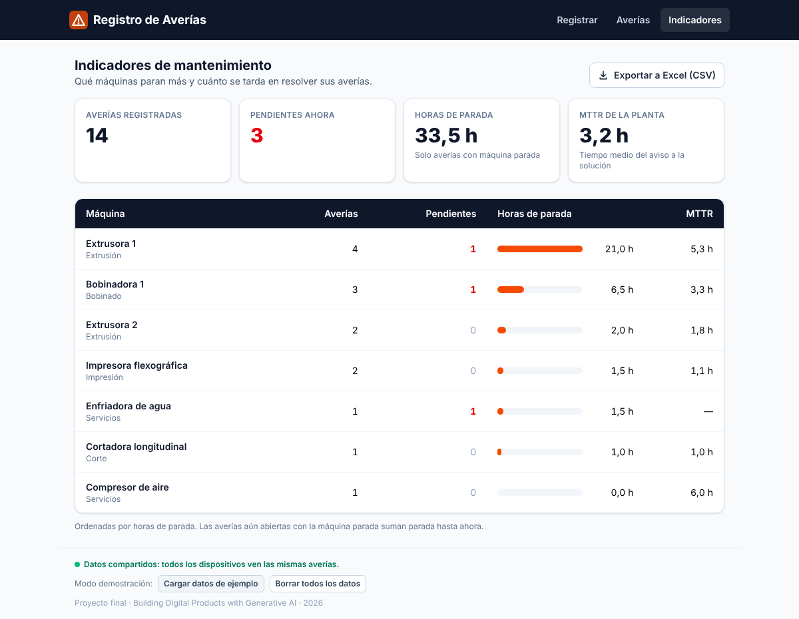
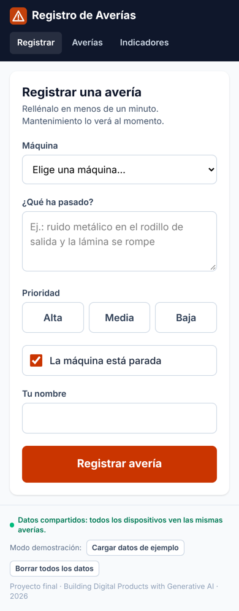
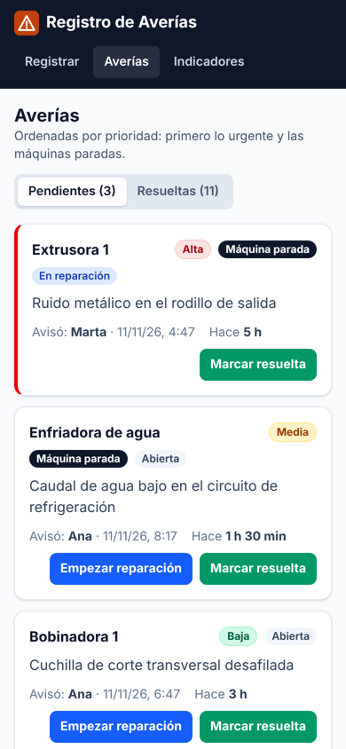

# Registro de Averías · Breakdown Log

**Operators report a machine breakdown in 20 seconds, maintenance sees it sorted by urgency, and the maintenance manager knows which machine stops the most.**

Final project of the course *Building Digital Products with Generative AI* (2026) · Jorge Iglesias Alsina.



---

## 1. What it is

**The problem.** In many small and medium manufacturing plants, breakdowns are reported by word of mouth or written on paper. I saw it first-hand during my internship at a plastic film factory: technicians have no list of what is pending, nobody knows how long each machine was stopped, and deciding where to do preventive maintenance is pure intuition.

**Who it is for.** Three people in the same plant:

| User | What they need |
| --- | --- |
| Line operator | Report a breakdown quickly, from a phone or a tablet, without looking for anyone |
| Maintenance technician | Know what to attend to first |
| Maintenance manager | See which machines stop the most and how long it takes to fix them |

**Minimum moment of value.** The operator reports the breakdown and the technician has it at the top of their list, sorted by priority, without a single phone call.

> **Language choice.** The user interface is in Spanish because the end users are Spanish plant workers. Code, commits and documentation are in English.

## 2. Features

MVP user stories, all implemented and tested:

| # | User story | Status |
| --- | --- | --- |
| US-01 | As a **line operator**, I want to report a breakdown (machine, description, priority and whether the machine is stopped), so that maintenance knows about it immediately without paper. | ✅ MVP |
| US-02 | As a **maintenance technician**, I want to see the pending breakdowns sorted by priority and change their status (open → in progress → resolved), so that I know what to attend to first. | ✅ MVP |
| US-03 | As the **maintenance manager**, I want to see per machine the number of breakdowns, the downtime hours and the MTTR, so that I can decide where to invest in preventive maintenance. | ✅ MVP |

**Backlog** (left out of the MVP on purpose): a shared database with users and login, CSV/Excel export, alerts to the technician (email or notification), MTBF and OEE indicators, and a screen to manage machines.

**What each screen does**

- **Registrar · Report** (`/`): mobile-first form. Validates the fields with messages in Spanish and remembers the operator's name for the next report.
- **Averías · Breakdowns** (`/breakdowns`): pending breakdowns sorted by priority, then stopped machines first, then the oldest. Each one can be moved to *In progress* or *Resolved*. A history tab lists the resolved ones.
- **Indicadores · Indicators** (`/indicators`): total breakdowns, pending, downtime hours and MTTR of the plant, plus a table per machine sorted by downtime.

**How the indicators are calculated**

- **Downtime hours.** Only breakdowns that stop the machine count, from the report to the resolution. While still open, they count until now.
- **MTTR** (*Mean Time To Repair*). Average time from the report to the resolution of the resolved breakdowns.

| Report (mobile) | Pending breakdowns (mobile) |
| --- | --- |
|  |  |

## 3. How to run it

**Live app:** https://breakdown-log-alpha.vercel.app

There is a **demo mode** in the page footer: *Cargar datos de ejemplo* (load sample data) fills the app with 14 realistic breakdowns from a plastic film plant, and *Borrar todos los datos* (delete all data) empties it.

### Requirements

- Node.js 20 or later, **or** Docker, **or** VS Code with the Dev Containers extension.
- No environment variables are needed. `.env.example` documents the ones a future database will need.

### Option A · Node.js

```bash
npm install
npm run dev        # http://localhost:5173
```

### Option B · Docker

```bash
docker compose up                                        # development -> http://localhost:5173
docker build --target prod -t breakdown-log . \
  && docker run -p 8080:80 breakdown-log                 # production with Nginx -> http://localhost:8080
```

### Option C · DevContainer

Open the folder in VS Code and choose **Reopen in Container**. The container comes with Node 22, Git, GitHub CLI and the Vue, Tailwind and Vitest extensions, and runs `npm install` on its own.

### Tests and quality

```bash
npm test           # 50 Vitest tests (domain, service, store, components and views)
npm run lint       # type-check with vue-tsc
npm run build      # production build to dist/
```

GitHub Actions (`.github/workflows/ci.yml`) runs all three on every push and pull request to `main` and `develop`.

### Deploying on Vercel

1. Vercel → **Add New → Project** → import this repository.
2. Vercel detects Vite: build command `npm run build`, output `dist`, production branch `main` → **Deploy**.
3. `vercel.json` sends every route to `index.html` (the app uses browser routing). `/api/health` is a function that answers `{"status":"ok"}`, for uptime monitoring with UptimeRobot.

### Structure

```
src/
  views/        pages: ReportView, BreakdownsView, IndicatorsView
  components/   BreakdownForm, BreakdownCard, KpiTile, DemoBar
  stores/       Pinia: breakdowns state
  services/     data access: the ONLY layer that touches storage
  domain/       pure, tested logic: validation, ordering, statuses, MTTR
  types/  data/ models, plant machines and sample data
tests/          50 tests, mirroring src/
api/health.ts   Vercel function for monitoring
docs/           AI workflow and screenshots
```

## 4. How it was built with AI

I built it with **Claude** (Anthropic) as the agent, following the course workflow: *requirement → prompt → plan → execution and test → commit*.

**My role:** defining the problem from my experience in a plant, choosing the idea and the scope, deciding what stayed out of the MVP and reviewing the result. **The agent's role:** proposing and writing the code, the tests and the configuration, and testing everything in a real browser before each merge.

**Environment for the agent**

- [`CLAUDE.md`](CLAUDE.md) with the problem, the user stories, the stack, the architecture, the definitions of the indicators and the working rules, such as *"implement only the user story requested"*, *"never change a test just to make it pass"* or *"UI in Spanish, code in English"*.
- Branches: `main` (production) and `develop` (integration). Every story in its own `feature/…` branch, merged with `--no-ff`. Conventional Commits.
- DevContainer, multi-stage Docker and CI on GitHub Actions from day one, before writing any feature.

**The cycle of each story** (details and full prompts in [`docs/ai-workflow.md`](docs/ai-workflow.md))

1. A prompt with the story and its acceptance criteria, on a `feature/` branch created from `develop`.
2. The agent implements it and writes tests for normal cases, edge cases and errors.
3. The whole suite, the type-check and the build are run.
4. It is tested in a real browser with Playwright (mobile and desktop) and the screenshots are reviewed.
5. Commit, merge into `develop`, and on to the next story.

**The US-02 prompt** (course template 4.1, adapted to the story):

> I want to build this feature: As a maintenance technician, I want to see the open breakdowns sorted by priority and change their status (open → in progress → resolved), so that I know what to attend to first. Acceptance criteria: high priority first, then stopped machines, then the oldest; a resolved breakdown cannot be reopened; a quick fix can go straight from open to resolved; every change is saved. Create a feature/breakdown-list branch from develop. Before writing any code, explain your plan and which files you will touch. Follow the conventions in CLAUDE.md and don't add anything that is not in the criteria.

**What worked well**

- **Separating the pure logic** (`src/domain/`) from the interface made it possible to test the business rules (priority order, status transitions, MTTR) with fast, deterministic tests: 50 tests in about 3 seconds.
- **Visual review** caught what the tests missed. In US-02 the card of an urgent breakdown had a black border instead of just the red one, and it was fixed before the merge.
- **Writing down the definitions** of "downtime" and "MTTR" in CLAUDE.md removed ambiguity: the agent and the tests use exactly the same formulas.

**What was hard or did not go as expected**

- **The data lives in a single browser.** Testing with two different browsers made it clear: what the operator reports on their phone **does not appear on the technician's PC**. The MVP works as a *shared terminal* (a tablet in the workshop or on the line), but the full value needs a shared database. The `services/` layer is isolated precisely so that `localStorage` can be replaced by an API without touching views or stores.
- **Docker and the DevContainer could not be run** in the agent's environment, which had no access to Docker Hub. The files follow the structure seen in the course, but they still have to be run on a computer with Docker.
- **The demo needed realistic data.** With an empty app the indicators show nothing, so a sample data loader was added, with tests that check its dates are consistent.

## 5. Status and next steps

**Status: MVP v0.1.0 complete.** The 3 stories work on mobile and desktop, with 50 passing tests, a clean type-check and build, and the Vercel, Docker, DevContainer and CI configuration ready.

**What it does not do yet:** share data between devices, identify users, alert the technician or manage machines (they are listed in `src/data/machines.ts`).

**Natural next step (v0.2.0):** a **shared database** (Vercel Postgres or Supabase) through functions in `/api`. That way the operator's report really reaches the technician on another device, which is the main promise of the product. After that: login by role (operator, technician, manager), CSV/Excel export and the MTBF and OEE indicators.
